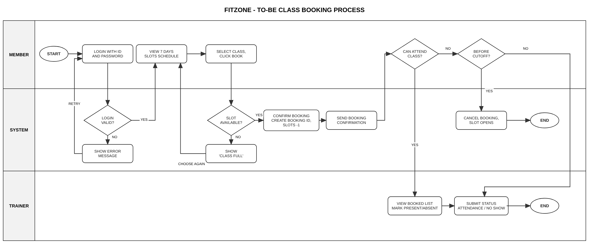
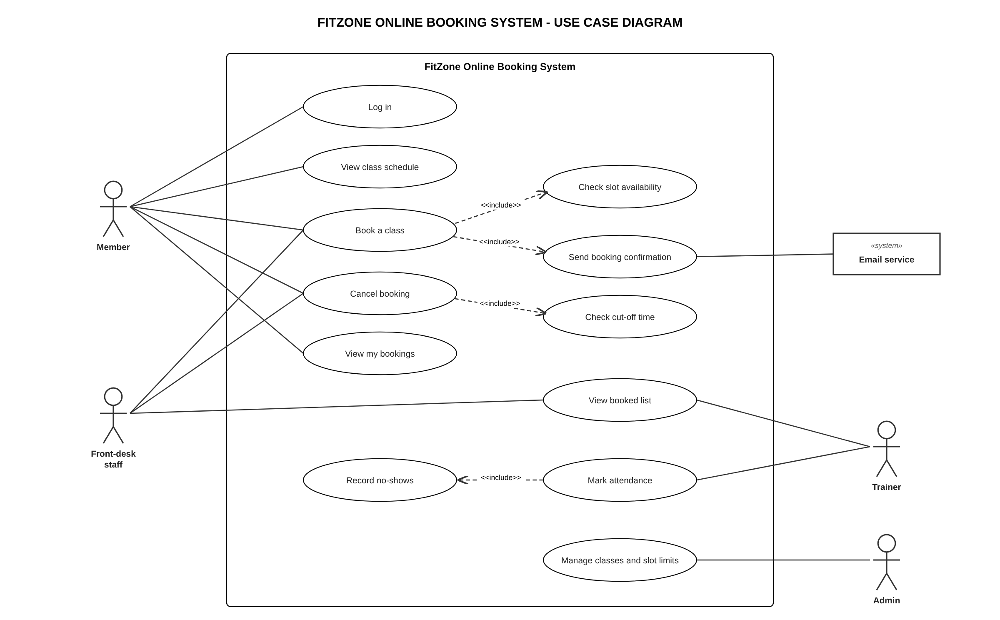

# FitZone-BA-Project
Business analysis portfolio project: BRD, FRD, process flow, wireframes, use case diagram, user stories and UAT test cases
# FitZone – Online Class Booking (Business Analysis Project)

A business analysis project I did to practise the full BA process, from understanding the problem through to user stories and UAT test cases.

FitZone is a made-up gym in Delhi with around 500 members. Group classes (Zumba, Yoga, HIIT, Spinning) are free with membership but need a booked slot, and bookings were being taken over WhatsApp and a paper register. That caused overbooked classes, no record of no-shows, and the front desk spending 3-4 hours a shift on bookings.

## What's in this repo

| File | What it is |
|---|---|
| `FitZone_BA_Project.pdf` | The full project in one document |
| `ToBe_Process_Flow.png` | To-Be swimlane (Member / System / Trainer) |
| `Use_Case_Diagram.png` | UML use case diagram |
| `FitZone_Wireframes.pdf` | 5 screens: login, class schedule, book a slot, my bookings, trainer attendance |

## What I did

1. **Understanding the need** – problem statement, problems, stakeholders, success measures
2. **BRD** – objectives, scope, As-Is / To-Be, 10 business requirements (MoSCoW), assumptions, risks, KPIs
3. **FRD** – user roles, 11 functional requirements, business rules, data requirements, NFRs, traceability matrix
4. **Process flow** – To-Be swimlane in draw.io
5. **Wireframes** – 5 screens in Axure with widget notes
6. **Use case diagram** – draw.io
7. **User stories** – 11 stories with acceptance criteria for a Jira backlog
8. **UAT test cases** – 11 test cases linked back to the requirements

## Process flow

## Use case diagram

## Tools

draw.io · Axure RP · Jira · MS Word / Excel

## Key targets set in the BRD

- Overbooked classes: ~20% → under 2%
- No-shows recorded for every class
- 80% of bookings made online by members
- Front-desk booking time cut by half

---
*Self-initiated portfolio project. FitZone and the client are fictional.*
